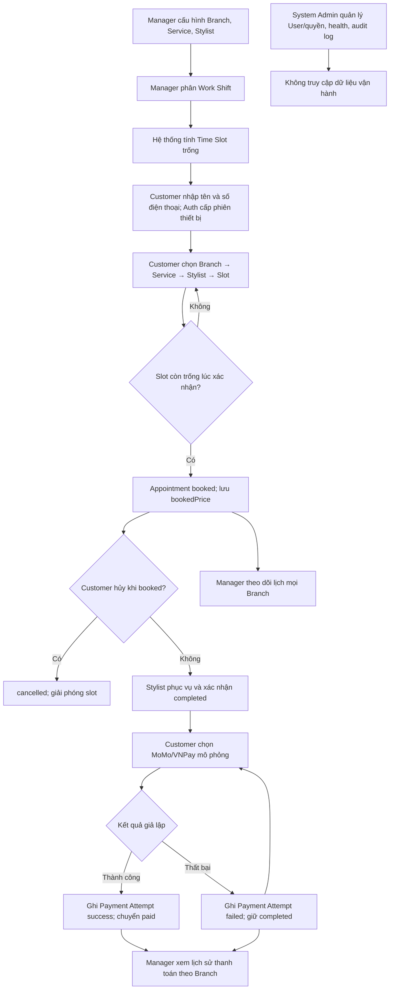

# Chương 3. Thiết kế hệ thống — trạng thái mục tiêu

> Sơ đồ liên vai trò là thiết kế đầy đủ. Core API đã lưu giá chốt, Payment Attempt mô phỏng và cung cấp API chỉ đọc cho Manager. Giao diện Manager trên mobile và việc thu hẹp Admin Web đang triển khai theo [kế hoạch](./superpowers/plans/2026-10-20-manager-mobile.md). Hợp đồng API hiện tại xem `/openapi.json` của Core.

## 3.1. Thành phần và ranh giới

| Thành phần | Trách nhiệm mục tiêu |
|---|---|
| `apps/mobile` | UI Customer và Stylist |
| `apps/admin-web` | UI riêng theo role: System Admin quản trị hệ thống, General Manager vận hành chuỗi |
| `services/auth-service` | Phiên Customer tên + số điện thoại; OTP demo khôi phục; tài khoản nhân sự và quyền |
| `services/core-api` | Branch, Service, Stylist Profile, Work Shift, Appointment, Payment Attempt và tra cứu vận hành |
| MongoDB | Lưu User và dữ liệu nghiệp vụ; audit log lưu bền vững |

System Admin không nhận quyền đọc catalog/Appointment/Payment của Core API. Manager có quyền trên tất cả Branch và không nhận quyền CRUD User. Kiểm tra quyền phải nằm ở API, không chỉ ẩn menu trên web. Health tổng hợp trạng thái Auth Service, Core API, database và thời điểm kiểm tra gần nhất; audit log chỉ lộ metadata sự kiện cần thiết.

## 3.2. Mô hình miền

```text
User nhân sự (một role; active/locked)
  └─ Stylist Profile (nếu role stylist)
Guest Session Customer (tên, số điện thoại, bí mật phiên thiết bị)
Branch
  ├─ Service (giá hiện hành, thời lượng)
  ├─ Stylist Profile (gán vào Branch)
  └─ Work Shift (Manager xếp)
       └─ Time Slot (suy ra)
            └─ Appointment (Customer, giá chốt lúc đặt)
                 └─ Payment Attempt (0..n; tối đa 1 thành công)
Audit Log (metadata thao tác quan trọng)
```

| Thực thể | Thuộc tính tối thiểu trong thiết kế |
|---|---|
| User nhân sự | id, email, passwordHash, role, trạng thái active/locked, thời điểm khóa (mục tiêu ADR 0006) |
| Guest Session | id, name, phone, deviceHash, verifiedAt |
| Recovery OTP | phone, digest, expiresAt, attempts, sentAt (demo; không gửi SMS) |
| Branch | id, name, address |
| Service | id, branchId, name, price, durationMinutes |
| Stylist Profile | userId, branchId, displayName, isActive |
| Work Shift | id, stylistId, branchId, date, startAt, endAt |
| Appointment | id, customerId, customerName, customerPhone, branchId, serviceId, stylistId, startAt, endAt, **bookedPrice**, status |
| Payment Attempt | id, appointmentId, branchId, amount, provider, status (success/failed), attemptedAt |
| Audit Log | id, actorId (có thể rỗng khi đăng nhập thất bại), action, targetType, targetId, result, occurredAt |

`bookedPrice` và `Payment Attempt.amount` là số tiền **mô phỏng**. Payment Attempt thất bại không làm đổi trạng thái Appointment. Các Payment Attempt của một lịch phải tham chiếu Branch của lịch đó; chỉ một lần thành công được ghi nhận và tính vào tổng tiền mô phỏng.

## 3.3. Flow liên vai trò



Slot được sinh từ ca theo thời lượng Service và bỏ khoảng giao với Appointment `booked`, `completed`, `paid`. Khi xác nhận, Core API kiểm tra chồng lịch lại bằng thao tác ghi có bảo vệ tranh chấp. Sửa/xóa ca không được làm lịch đang hoạt động mất ca hợp lệ.

## 3.4. Flow chi tiết theo vai trò

**Customer:** Nhập tên + số điện thoại → nhận phiên trên thiết bị → chọn Branch → Service (giá/thời lượng) → Stylist → ngày/slot → xác nhận giá chốt và `booked` → xem/hủy lịch của phiên → đến salon → sau `completed` chọn thanh toán mô phỏng → xem thành công hoặc thử lại nếu thất bại. Trên thiết bị khác, Customer vẫn vào app ngay nhưng cần OTP demo để xem/hủy/thanh toán lịch cũ cùng số. Tất cả màn thanh toán phải ghi “Mô phỏng, không trừ tiền thật”.

**Stylist:** Đăng nhập → xem lịch hôm nay theo ca → mở chi tiết lịch của mình → phục vụ → đánh dấu `completed`. Stylist không tạo Work Shift và không thanh toán thay Customer.

**General Manager:** Đăng nhập web → tổng quan lịch hôm nay → lọc theo ngày/Branch/Stylist/trạng thái → quản lý Branch/Service/Stylist Profile → phân Work Shift → xem lịch sử Payment Attempt theo Branch (thành công và thất bại) cùng tổng thành công. Manager không tạo User; chỉ gán hồ sơ cho User `stylist` đã được Admin cấp.

**System Admin:** Đăng nhập web → quản lý tài khoản nhân sự/role → tạo, sửa, khóa mềm, khôi phục → xem health Auth/Core/database → lọc audit log. Customer Guest không nằm trong danh sách. Chặn khóa/đổi role Stylist nếu còn ca tương lai hoặc lịch chưa xử lý. Admin không vào màn lịch, catalog hay thanh toán.

## 3.5. Danh sách màn hình mục tiêu

| Role | Màn hình | Tác vụ chính |
|---|---|---|
| Customer | Nhập tên + số điện thoại; Trang chủ; Chọn Branch; Chọn Service; Chọn Stylist; Chọn ngày/slot; Xác nhận | Tạo Appointment `booked` với giá chốt, không dùng email/mật khẩu |
| Customer | Lịch của tôi; Khôi phục lịch bằng OTP demo; Chi tiết lịch; Thanh toán mô phỏng; Kết quả; Lịch sử | Hủy `booked`, thanh toán `completed`, xem `paid` |
| Stylist | Đăng nhập; Lịch hôm nay; Chi tiết lịch | Xem lịch được giao và đánh dấu hoàn thành |
| General Manager | Tổng quan; Chi nhánh; Dịch vụ; Hồ sơ thợ; Phân ca | Quản lý catalog và lịch làm |
| General Manager | Lịch đặt; Chi tiết lịch; Lịch sử thanh toán | Lọc lịch/ngày/Branch/Stylist/trạng thái, tra cứu giao dịch theo Branch |
| System Admin | Tài khoản nhân sự; Tạo/sửa User; Chi tiết/đổi quyền; Khóa/khôi phục | Quản trị tài khoản nhân sự |
| System Admin | Health; Audit log | Xem trạng thái dịch vụ/database và tra cứu sự kiện |

## 3.6. Chuyển đổi từ code hiện tại

Flow Customer tên + số điện thoại và OTP demo đã có trong Auth/mobile/Core (ADR 0007); Customer email/mật khẩu cũ không được chuyển dữ liệu, vẫn nằm trong database nhưng không đăng nhập được bằng flow nhân sự. SHINE-26 chuyển `shop_admin` cũ sang `system_admin`, chuyển quyền catalog/Work Shift sang `general_manager`, đóng đăng ký User công khai và bổ sung quản lý tài khoản, health, audit log. Core API hiện ghi Payment Attempt và chỉ đưa lịch sang `paid` sau attempt thành công; lịch cũ không có `bookedPrice` được giữ nguyên và không thể thanh toán mô phỏng. Giao diện mobile Manager vẫn đang triển khai.
