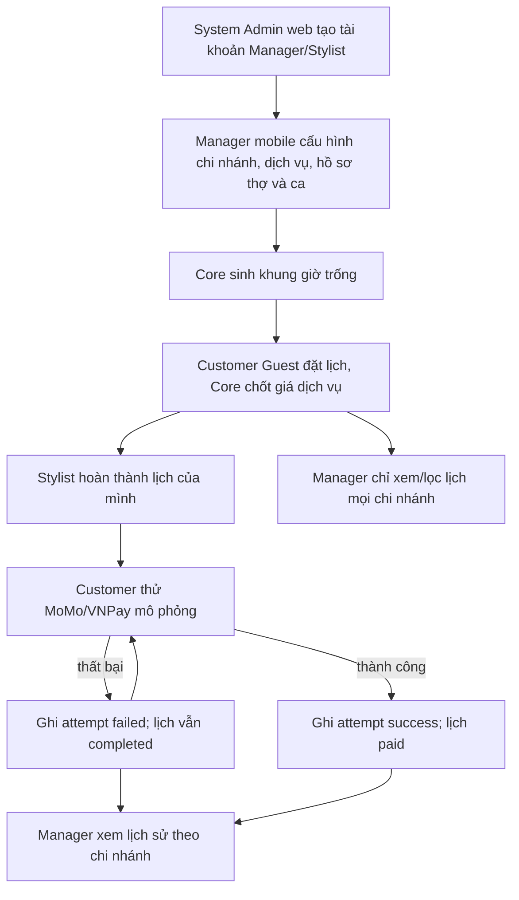

# Manager trên app React Native — thiết kế đã thống nhất

Ngày: 2026-10-20

Trạng thái: Chờ duyệt đặc tả trước khi lập kế hoạch triển khai

## 1. Mục tiêu và quyết định

Đồ án tập trung vào React Native. Một app Expo phục vụ ba vai trò `customer`, `stylist` và `general_manager`, mỗi vai trò có khu vực màn hình riêng. `system_admin` chỉ dùng Admin Web để quản lý tài khoản nhân sự, health và audit log. General Manager có quyền trên mọi chi nhánh, nhưng không quản lý tài khoản, không xem audit/health và không đổi trạng thái lịch hẹn thay Customer hoặc Stylist.

Chuyển toàn bộ chức năng Manager mục tiêu lên app: danh mục chi nhánh/dịch vụ/hồ sơ thợ, phân ca, tổng quan và lọc lịch đặt, lịch sử thanh toán mô phỏng theo chi nhánh. Admin Web ngừng nhận role `general_manager`; các API Core hiện có vẫn là nguồn dữ liệu chung.

## 2. Hiện trạng cần chuyển đổi

- Mobile có Guest Session cho Customer và đăng nhập email/mật khẩu chỉ cho Stylist. `AuthProvider` và `RoleProvider` chưa cho Manager vào; Expo Router mới có nhóm `(customer)` và `(stylist)`.
- Admin Web đang chứa giao diện Manager cho catalog và Work Shift. Core đã giới hạn API ghi catalog/ca cho `general_manager`, còn Auth tạo tài khoản nhân sự qua System Admin.
- Core chưa có API liệt kê mọi lịch theo ngày/chi nhánh/thợ/trạng thái cho Manager. Appointment chưa lưu giá chốt; thanh toán mô phỏng hiện chỉ đổi `completed → paid`, chưa có Payment Attempt hoặc lịch sử theo chi nhánh.
- Mobile có cơ chế offline đọc cache cho lịch Customer. Thao tác Manager cần kết nối mạng; lỗi mạng phải hiện trạng thái và nút thử lại, không xếp hàng thao tác ghi ngoại tuyến.

## 3. Điều hướng và đăng nhập

Màn vào app giữ lựa chọn Customer theo tên/số điện thoại và lối đăng nhập nhân sự bằng email/mật khẩu. Một lần đăng nhập nhân sự gọi `/auth/login`; role trả về quyết định khu vực: `stylist → (stylist)`, `general_manager → (manager)`. App không cho `system_admin` vào. Phiên đã lưu được phục hồi theo role sau khi mở lại app. Đăng xuất xóa token và trạng thái role. Token nhân sự bị khóa/đổi role hết hiệu lực qua `/auth/introspect`; khi API trả 401, app xóa phiên và đưa về màn vào.

Nhóm `(manager)` được bảo vệ theo role trong Expo Router. Các màn Customer/Stylist/Manager không lẫn điều hướng hoặc dữ liệu. Bảo vệ màn ở client chỉ phục vụ điều hướng; Auth/Core tiếp tục thực thi quyền ở server trên mọi API.

## 4. Màn Manager trên điện thoại

| Khu vực | Màn và tác vụ |
|---|---|
| Tổng quan | Ngày hiện tại tại `Asia/Ho_Chi_Minh`, chọn chi nhánh hoặc tất cả; số lịch `booked`, `completed`, `paid`, `cancelled`; truy cập nhanh lịch hôm nay và ca. Không hiển thị tổng thu thật. |
| Lịch đặt | Danh sách và chi tiết lịch; lọc ngày, chi nhánh, thợ, trạng thái; hiển thị tên/số liên hệ khách khi có, dịch vụ, giờ, giá chốt, trạng thái. Chỉ xem, không có nút hoàn thành/hủy/trả tiền. |
| Vận hành | Danh sách/chi tiết/tạo/sửa chi nhánh; dịch vụ gồm giá và thời lượng; hồ sơ thợ và gán thợ đã có tài khoản `stylist` vào chi nhánh; xem/tạo/sửa/xóa ca theo ngày, chi nhánh, thợ. Các thao tác xóa catalog/hủy gán hiện có được giữ với xác nhận và quy tắc ràng buộc đang có trên server. Manager không tạo User. |
| Thanh toán | Chọn chi nhánh, lọc ngày/khoảng ngày, xem từng Payment Attempt `success`/`failed` theo lịch; tổng thu mô phỏng chỉ cộng attempt thành công. Ghi rõ: **Thanh toán mô phỏng, không trừ tiền thật.** |

Bốn khu vực là bốn tab chính. Danh mục và form chi tiết đi sâu từ tab Vận hành để tab bar không bị quá tải. Danh sách dài dùng phân trang; mọi thao tác ghi hiển thị tải, lỗi, kết quả và làm mới dữ liệu. Mobile dùng danh sách/thẻ và bộ lọc thu gọn, không sao chép bảng rộng của Admin Web.

## 5. Flow liên vai trò

## 6. Dữ liệu và API Core

### Giá chốt và Payment Attempt

Khi Customer xác nhận booking, Core lấy giá từ Service đang hoạt động và ghi `bookedPrice` vào Appointment cùng `branchId`/`serviceId`; không tin giá do mobile gửi. Sửa giá Service về sau không đổi `bookedPrice` của lịch đã đặt. Chỉ Appointment `completed` và đúng Customer sở hữu mới thử thanh toán. Mobile chọn `momo` hoặc `vnpay` và kết quả demo minh bạch; không gọi cổng thật, không lưu thẻ/ví/khóa bí mật.

Mỗi lần thử hợp lệ ghi Payment Attempt gồm `id`, `requestId` chống gửi lặp, `appointmentId`, `branchId`, `amount = bookedPrice`, `provider`, `status` (`success` hoặc `failed`) và `attemptedAt`. Attempt thất bại giữ lịch `completed`; attempt thành công chuyển sang `paid`. Một lịch có tối đa một attempt thành công. Để tránh trạng thái thanh toán và bản ghi attempt lệch nhau trên MongoDB standalone, Payment Attempt được lưu như subdocument của Appointment đang nằm trong Stylist Calendar; thao tác thêm attempt và đổi trạng thái dùng một cập nhật nguyên tử trên cùng document. Lịch sử Manager được truy vấn/chiếu từ các subdocument này. Retry cùng `requestId` trả cùng kết quả thay vì tạo attempt thứ hai.

Lịch cũ thiếu `bookedPrice` không tự lấy giá Service hiện tại làm giá lịch sử; API trả lỗi rõ khi thử trả tiền cho lịch đó. Payment Attempt và tổng thu chỉ áp dụng các lịch có dữ liệu mới. Không tự xóa lịch Customer cũ trong lần chuyển giao diện này.

### API Manager mới

| API dự kiến | Quyền | Kết quả |
|---|---|---|
| `GET /manager/overview?date=&branchId=` | `general_manager` | Số lịch theo trạng thái trong ngày; ngày mặc định theo Việt Nam. |
| `GET /manager/appointments?date=&branchId=&stylistId=&status=&cursor=&limit=` | `general_manager` | Danh sách có phân trang, toàn bộ chi nhánh hoặc theo bộ lọc; chỉ trường cần cho giao diện. |
| `GET /manager/appointments/:id` | `general_manager` | Chi tiết một lịch và giá chốt, không kèm quyền chuyển trạng thái. |
| `GET /manager/payments?branchId=&from=&to=&cursor=&limit=` | `general_manager` | Payment Attempt của một chi nhánh, cả thành công/thất bại; tổng thu mô phỏng chỉ tính thành công. `branchId` bắt buộc. |

Catalog và Work Shift tiếp tục dùng API hiện có. `POST /appointments/:id/pay` mở rộng body cho `provider`, kết quả mô phỏng và `requestId`; response trả Appointment cùng Payment Attempt. API validate input, quyền sở hữu, trạng thái và chống gửi lặp. OpenAPI/README phải mô tả chính xác code sau triển khai, không trình bày API mới như đã có trước khi viết code.

## 7. Ranh giới quyền và web

- System Admin Web chỉ chấp nhận `system_admin`; bỏ giao diện và điều hướng Manager khỏi Admin Web. Tài khoản Manager vẫn do System Admin tạo/sửa/khóa ở web.
- Manager mobile dùng đúng JWT nhân sự; Core chỉ cho `general_manager` đọc dữ liệu tổng hợp, catalog và ca. Không cho Manager gọi `/admin/users`, `/admin/health`, `/admin/audit` hay chuyển trạng thái lịch.
- Customer Guest chỉ thấy lịch của phiên/số đã khôi phục, không được truy vấn Manager; Stylist chỉ thấy lịch được giao. Cả hai không đọc lịch sử thanh toán toàn chi nhánh.
- Số điện thoại Customer chỉ hiển thị trong chi tiết lịch cho Manager đã đăng nhập; audit log không ghi body, số điện thoại hoặc dữ liệu thanh toán nhạy cảm.

## 8. Kiểm tra chấp nhận

1. Đăng nhập ba role trên cùng app; role sai không mở được nhóm màn khác. System Admin bị từ chối trên mobile và chỉ vào web; Manager bị từ chối trên web.
2. Manager tạo/sửa chi nhánh, giá/thời lượng, gán Stylist hợp lệ, xếp ca; Customer thấy slot, đặt lịch với `bookedPrice`; sửa giá sau đó không thay giá lịch cũ.
3. Manager lọc lịch theo ngày/chi nhánh/thợ/trạng thái; không thấy nút và không gọi được API đổi trạng thái. Stylist hoàn thành, Customer hủy/trả tiền theo quyền hiện hành.
4. Thử thanh toán thất bại rồi thành công: có hai attempt, lịch chỉ chuyển `paid` khi thành công; retry cùng `requestId` không ghi trùng; tổng theo chi nhánh chỉ tính lần thành công.
5. System Admin/Customer/Stylist gọi API Manager nhận 403; token nhân sự bị khóa nhận 401. API không trả dữ liệu nhạy cảm ngoài quyền.
6. Mobile báo lỗi mạng và cho thử lại; không gửi lại thao tác ghi tự động. Chạy test Auth/Core/Mobile, typecheck, Android bundle và kiểm tra luồng trên thiết bị/emulator.

## 9. Ngoài phạm vi

Không tích hợp MoMo/VNPay thật, không gửi SMS OTP, không đưa System Admin vào mobile, không cho Manager tạo User hoặc sửa/hủy trạng thái Appointment. Không xây hệ thống báo cáo tài chính thật; mọi số tiền trong màn Thanh toán là mô phỏng.
